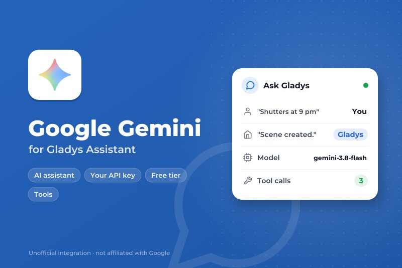
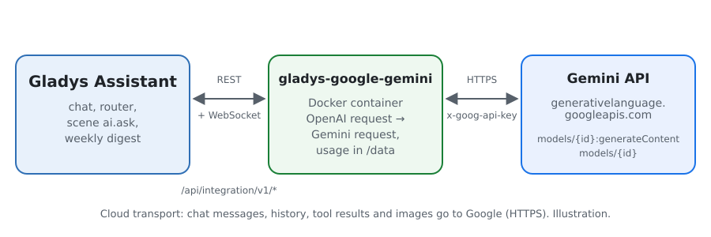
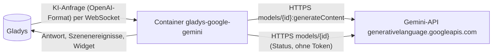
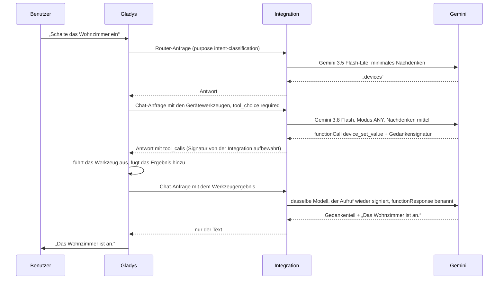
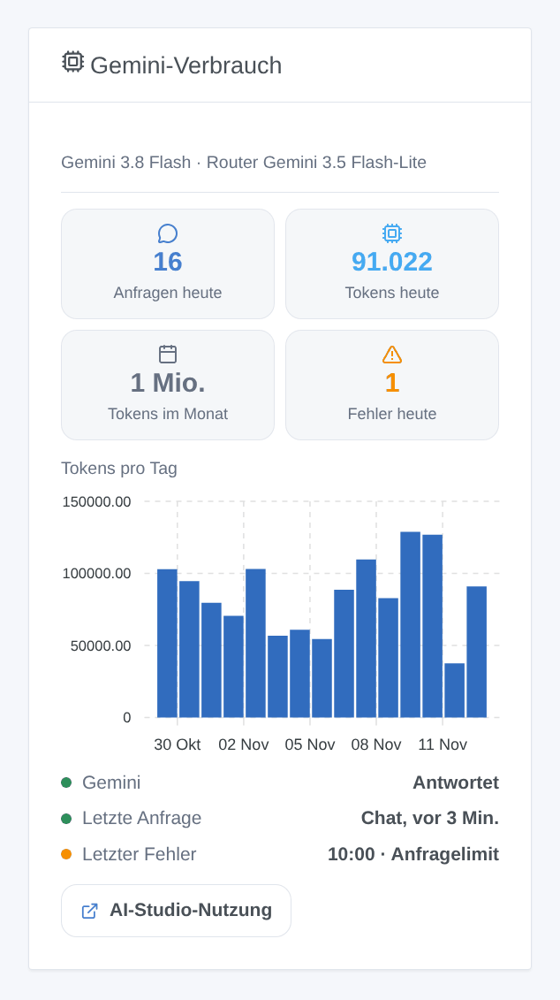

# Gladys Google Gemini

[English](README.md) · [Français](README.fr.md) · **Deutsch** · [Español](README.es.md)

[](LICENSE)
[](https://github.com/William-De71/gladys-google-gemini/releases)
[](https://github.com/William-De71/gladys-google-gemini/actions/workflows/release.yml)
[](https://gladysassistant.com)



Externe Integration für [Gladys Assistant](https://gladysassistant.com), die den Assistenten von Gladys mit **Google Gemini** betreibt, über die offizielle Gemini-API und deinen eigenen API-Schlüssel aus Google AI Studio. Sobald Gemini unter Einstellungen → Künstliche Intelligenz ausgewählt ist, beantwortet es den Chat, steuert deine Geräte, erstellt Szenen, beantwortet die Szenenaktion „die KI fragen“ und schreibt den Wochenrückblick — mit oder ohne Gladys-Plus-Konto, und der kostenlose Tarif reicht für den Anfang.

Benutzerdokumentation: [English](docs/en.md) · [Français](docs/fr.md) · [Deutsch](docs/de.md) · [Español](docs/es.md).

Nicht mit Google verbunden. **Noch nicht mit einem echten Gemini-Schlüssel getestet**: Die Anfragen folgen der offiziellen REST-Referenz der Gemini-API, und die Tests laufen gegen eine gefälschte API. Rückmeldungen sind willkommen.

## Funktionen

- **KI-Anbieter** (`type: "ai"`, Gladys 5.3+): Alle KI-Anfragen von Gladys gehen an Gemini — der Chat mit seinen Werkzeugaufrufen, der Absicht-Router, die Szenenaktion „die KI fragen“, der Wochenrückblick.
- **Zwei Modelle**: ein Chat-Modell (standardmäßig Gemini 3.8 Flash) und ein schnelles Router-Modell (standardmäßig Gemini 3.5 Flash-Lite), oder jede andere Gemini-Modell-ID.
- **Nachdenkstufe** des Chat-Modells (minimal, niedrig, mittel, hoch), angepasst an das, was jedes Modell akzeptiert.
- **Gedankensignaturen bleiben erhalten** zwischen den Durchgängen eines Gesprächs, wie es Gemini 3 und neuer für Werkzeugaufrufe verlangen.
- **Szenenauslöser**: Der Assistent schlägt fehl (Schlüssel abgelehnt, Abrechnung oder kostenloser Tarif, Anfragelimit, Modell nicht verfügbar, API nicht erreichbar) und antwortet wieder — einmal pro Ausfall.
- **Dashboard-Widget**: Anfragen und Tokens des Tages und des Monats, Tokens pro Tag über 30 Tage, letzte Antwort und letzter Fehler.
- Schaltfläche **Verbindung testen**; die Konfigurationsseite zeigt, ob Google den Schlüssel und die Modelle akzeptiert.
- Anfragen mit abgeschalteter Protokollierung (`store: false`). Englisch, Französisch, Deutsch und Spanisch.

## Funktionsweise





Die gesamte agentische Schleife (Prompts, Werkzeuge, Verlauf, Verkleinerung der Bilder) bleibt in Gladys; die Integration übersetzt jede Anfrage und ihre Antwort:



Was die Übersetzung übernimmt: Systemnachrichten nach `systemInstruction`, Durchgänge nach `contents` mit den Rollen `user` und `model`, Werkzeugaufrufe als `functionCall`-Teile (Argumente als Objekte), Werkzeugergebnisse als `functionResponse`-Teile, benannt nach ihrem Aufruf (Gladys wiederholt den Namen nicht), Bilder aus Data-URLs nach `inlineData`, `tool_choice` nach `functionCallingConfig` (`required` → `ANY`), das JSON Schema der Werkzeuge nach `parametersJsonSchema`, Gedankenteile aus dem Text entfernt, der Verbrauch mit dem Nachdenken als Ausgabe gezählt. Ein 429 oder 5xx wird erneut versucht, solange die Wartezeit des Kerns es erlaubt (18 s für den Router, 110 s für den Chat), unter Beachtung von `Retry-After` und Googles `RetryInfo`; ein fehlerhafter Funktionsaufruf wird einmal neu angefragt.

**Gedankensignaturen**: Gemini 3 und neuer signieren die Teile, die sie erzeugen, und lehnen (HTTP 400) einen Verlauf ab, dessen Funktionsaufrufe ihre Signatur verloren haben. Gladys behält nur die OpenAI-Felder: Die Integration merkt sich die Signaturen daher im Speicher, pro Aufruf-ID, sechs Stunden lang, und setzt sie wieder ein. Ein Aufruf, den sie nie gesehen hat (nach einem Neustart oder bei einem Verlauf eines anderen Anbieters), erhält den Wert, den Google für diesen Fall dokumentiert, `skip_thought_signature_validator`.

### Transport

`transports: ["cloud"]`: Alles geht per HTTPS an `generativelanguage.googleapis.com`, der Schlüssel im Header `x-goog-api-key`. **Google sieht jede Chat-Nachricht, den Verlauf, die Definitionen und Ergebnisse der Werkzeuge (den Zustand der Geräte, die es abfragt) und die Bilder des Chats**, und seine Antworten steuern deine Geräte und Szenen. Außerhalb des Europäischen Wirtschaftsraums, der Schweiz und des Vereinigten Königreichs darf Google die Anfragen des kostenlosen Tarifs zur Verbesserung seiner Produkte nutzen; in diesen Ländern und überall mit einem Abrechnungskonto tut es das nicht. Gladys weicht nie auf Gladys Plus aus, wenn Gemini fehlschlägt: Der Chat sagt, was nicht stimmt. `/data` speichert nur die Zähler des Widgets.

## Modelle

| Modell                | API-ID                  | Verwendung                                                            | Nachdenken                            | Kostenlos |
| --------------------- | ----------------------- | --------------------------------------------------------------------- | ------------------------------------- | --------- |
| Gemini 3.8 Flash      | `gemini-3.8-flash`      | Chat (Standard): das beste des kostenlosen Tarifs (Werkzeuge, Szenen) | niedrig, mittel, hoch                 | ja        |
| Gemini 4 Argon        | `gemini-4-argon`        | Chat: am leistungsfähigsten                                           | niedrig, mittel, hoch                 | nein      |
| Gemini 3.6 Flash      | `gemini-3.6-flash`      | Chat: das vorherige Flash                                             | minimal bis hoch                      | ja        |
| Gemini 3.5 Flash-Lite | `gemini-3.5-flash-lite` | Router (Standard): schnell, unter den 20 s, die Gladys ihm gibt       | minimal bis hoch                      | ja        |
| Gemini 3.1 Flash-Lite | `gemini-3.1-flash-lite` | Router; Abschaltung für Mai 2027 geplant                              | minimal bis hoch                      | ja        |
| Anderes Modell        | deine ID                | Ein neueres Modell, eine Vorschau: Es muss Funktionen aufrufen        | wie gewünscht, entfällt bei Ablehnung | —         |

IDs, Nachdenkstufen und Tarife am 2. November 2026 in der Dokumentation der Gemini-API geprüft. Vorschaumodelle stehen nicht in den Listen (sie ändern sich und verschwinden): Nutze „Anderes Modell“.

## Szenen und Widget



- **Auslöser „Gemini: Der Assistent schlägt fehl“**: Variablen `kind` (`auth`, `billing`, `rate_limit`, `model`, `unreachable`, `timeout`, `server`), `message`, `use`, `model`; Filter nach Art. Eine abgelehnte Anfrage (HTTP 400, von den Sicherheitsfiltern gestoppte Antwort) betrifft nur sie und löst nichts aus.
- **Auslöser „Gemini: Der Assistent antwortet wieder“**: Variable `down_minutes`.
- **Widget „Gemini-Verbrauch“**: von der Integration aus dem `usageMetadata` jeder Antwort gezählt, Nachdenken inklusive; Anfragen außerhalb von Gladys mit demselben Schlüssel sind nicht enthalten. Google AI Studio bleibt die Referenz für die Rechnung.
- **Keine Websuche-Aktion**: Die Bedingungen der Fundierung mit der Google-Suche verlangen, Googles Suchvorschläge mit jeder fundierten Antwort anzuzeigen, und verbieten, sie zu ändern; eine Szene, die sie vorliest oder per SMS sendet, kann das nicht.

Beispiele:

- _Wenn der Assistent fehlschlägt_ (Art `rate_limit` oder `billing`) → eine Telegram-Nachricht mit `{{triggerEvent.data.message}}` an den Administrator senden.
- _Wenn der Assistent wieder antwortet_ → „Gemini ist nach `{{triggerEvent.data.down_minutes}}` Min. zurück“ senden.

## Voraussetzungen

- Gladys Assistant **5.3.0** oder neuer (KI-Anbieter); ältere Instanzen können die Integration nicht installieren.
- Ein Google-Konto und ein Gemini-API-Schlüssel aus [Google AI Studio](https://aistudio.google.com/apikey).

### Tarife und Limits

- **Kostenloser Tarif**: alle Modelle der Listen außer Gemini 4 Argon, mit niedrigen Limits pro Minute und pro Tag, pro Projekt (Zurücksetzung um Mitternacht pazifischer Zeit), sichtbar in AI Studio → Rate limit.
- **Bezahlter Tarif** (ein mit dem Projekt verknüpftes Abrechnungskonto): höhere Limits, die mit den Ausgaben wachsen, Gemini 4 Argon, Abrechnung pro Token (Nachdenk-Tokens als Ausgabe abgerechnet). Die Preise stehen auf der Preisseite der Gemini-API.
- Ein Chat-Durchgang von Gladys macht mindestens zwei Anfragen (Router, dann Chat), mehr, wenn Werkzeuge aufgerufen werden: Ein 429 wird innerhalb der Zeit, die Gladys wartet, erneut versucht; eine längere von Google verlangte Wartezeit schlägt sofort mit ihrem Grund fehl.
- Googles Bedingungen behalten die Gemini-API Entwicklern vor, die damit bauen; im Europäischen Wirtschaftsraum, in der Schweiz und im Vereinigten Königreich verlangen sie bezahlte Dienste, wenn eine App anderen Nutzern angeboten wird. Lies sie für deine Nutzung.

## Installation

- **Aus dem Store**: Integrationen → Google Gemini → Installieren.
- **Über die URL des Repositorys**: Integrationen → externe Integration → `https://github.com/William-De71/gladys-google-gemini`.
- **Entwicklermodus**: Starte `npm start` mit den Variablen, die Gladys bereitstellt (siehe Entwicklung).

## Konfiguration

| Feld oder Schaltfläche | Standard              | Bedeutung                                                              |
| ---------------------- | --------------------- | ---------------------------------------------------------------------- |
| Gemini-API-Schlüssel   | —                     | Pflicht, geheim: wird nie wieder angezeigt und nie protokolliert       |
| Chat-Modell            | Gemini 3.8 Flash      | Chat, Erstellen von Szenen, Wochenrückblick                            |
| Router-Modell          | Gemini 3.5 Flash-Lite | Ordnet jede Nachricht vor der Antwort ein, innerhalb von 20 s          |
| ID des anderen Modells | —                     | Wird verwendet, wenn ein Modell auf „Anderes Modell“ steht             |
| Nachdenken             | mittel                | Des Chat-Modells; der Router nimmt die niedrigste Stufe seines Modells |
| Maximale Antwortlänge  | 16000 Tokens          | Nachdenken inklusive; erhöhen, wenn die Protokolle max_tokens melden   |
| Verbindung testen      | —                     | Eine kurze Antwort jedes Modells mit ihrer Dauer (ein paar Tokens)     |

## Verwendung

1. In Gladys (Integrationen → Google Gemini → Konfiguration): Füge den API-Schlüssel ein, wähle die Modelle und drücke **Verbindung testen**.
2. Einstellungen → **Künstliche Intelligenz**: Wähle **Google Gemini** als Anbieter.
3. Sprich im Chat mit Gladys; füge das Widget einem Dashboard hinzu; nutze die Auslöser in deinen Szenen.

## Entwicklung

```bash
npm install
npm test                       # node --test, eine gefälschte Gemini-API auf 127.0.0.1, nie das Netzwerk
npm run lint                   # ESLint
npm run format:check           # Prettier
npx github:GladysAssistant/integration-store . --skip-image-check
scripts/build-cover.sh         # cover.jpg aus docs/assets/cover.svg
docs/illustrations/render.sh   # docs/assets/widgets.<lang>.png
```

Lokal liest das SDK `GLADYS_HOST_API_URL`, `GLADYS_INTEGRATION_TOKEN` und `GLADYS_INTEGRATION_SELECTOR` (von Gladys im Entwicklermodus bereitgestellt), und die Integration liest `TZ`. `DEBUG=gladys-integration-sdk` zeigt die Protokolle des SDK.

Die Tests decken den HTTP-Client (Fehler, Wiederholungen, Fristen), die Übersetzung in beide Richtungen (`validateAiCompletion` des SDK), die Gedankensignaturen, den Chat-Handler (Modelle pro Zweck, Nachdenken, abgelehnter Parameter, fehlerhafte Aufrufe, Filter), die Auslöser, die Zähler, das Widget (`validateWidgetContent`), das Manifest, die vier Sprachen, das Release-Skript und die ganze Integration gegen das gefälschte Gladys des SDK ab. `test/structure.test.js` friert alle Schlüssel ein, die Benutzer speichern.

## Release-Prozess


Jede Zusammenführung auf `main` startet die CI und berechnet dann die Version aus den [Conventional Commits](https://www.conventionalcommits.org/) seit dem letzten Tag: `feat` → Minor, `fix` / `perf` → Patch, `!` oder `BREAKING CHANGE` → Major (ein Minor vor 1.0.0); `docs`, `chore`, `ci`, `test`, `style`, `refactor`, `build` allein veröffentlichen nichts. Der Changelog-Abschnitt wird erzeugt, der Tag gepusht, das Multi-Architektur-Image gebaut, dann erhält `main` den Release-Commit, das GitHub Release wird erstellt und ein letzter Job prüft das öffentliche Image, den Store-Validator und das Topic.

- Der Titel des Pull Requests wird zum Squash-Commit und dann zur Changelog-Zeile: Schreibe ihn auf Englisch, für den Benutzer (`pr-title.yml` prüft ihn). Bearbeite `CHANGELOG.md` nie von Hand.
- 1.0.0 ist eine Entscheidung: Actions → Release → Run workflow mit `release-as: 1.0.0`. `dry-run` zeigt Version und Notizen, ohne etwas zu veröffentlichen.
- **Geschützter Branch**: Das Release pusht seinen Commit mit `GITHUB_TOKEN` auf `main`. Das Ruleset `protect-main` (weder Löschen noch Force-Push) lässt ihn durch; eine strengere Regel (Pull Request Pflicht, Status Checks) bräuchte GitHub Actions in der Bypass-Liste oder eine GitHub App.
- Mache nach dem ersten Release das Paket `ghcr.io` öffentlich (Package settings → Change visibility), sonst kann Gladys es nicht herunterladen.

## Fehlerbehebung

Siehe [docs/de.md](docs/de.md#fehlerbehebung). Melde Probleme mit den Versionen von Gladys und der Integration, den gewählten Modellen, deinem Tarif und Land und der Meldung von **Verbindung testen**. Füge niemals deinen API-Schlüssel ein.

## Mitwirken

Issues und Pull Requests sind willkommen, vor allem von Leuten mit einem Gemini-Schlüssel: Eine fehlschlagende Anfrage (ohne den Schlüssel) hilft sehr. Führe `npm run format:check && npm run lint && npm test` aus, bevor du einen Pull Request öffnest, und ändere keinen gespeicherten Schlüssel (siehe [CLAUDE.md](CLAUDE.md)).

## Sicherheit

Siehe [SECURITY.md](SECURITY.md): Melde Sicherheitslücken vertraulich. Der API-Schlüssel ist ein `secret`-Feld: nie protokolliert, nie in `/data` geschrieben, nur per HTTPS in einem Header an `generativelanguage.googleapis.com` gesendet.

## Kommende Screenshots

Die Bilder oben sind Illustrationen, keine Screenshots. Echte Screenshots kommen nach `docs/assets/screenshots/` (PNG, 1280 × 800): `configuration.png` (die Konfiguration mit ihrem Status), `ai-settings.png` (Gemini unter Einstellungen → Künstliche Intelligenz gewählt), `chat.png` (ein Chat, der ein Gerät einschaltet).

## Lizenz

[Apache License 2.0](LICENSE) — siehe auch [NOTICE](NOTICE). Google, Gemini und Google AI Studio sind Marken von Google LLC; dieses Projekt ist nicht mit Google verbunden und wird von Google weder unterstützt noch gesponsert. Danke an die Dokumentation und das SDK von Gladys sowie an die Dokumentation der Gemini-API.
