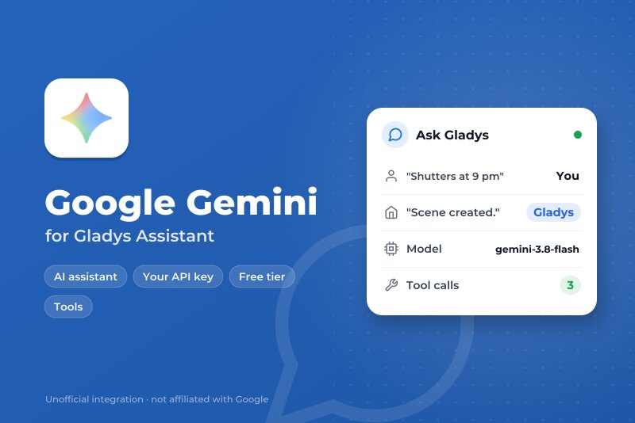
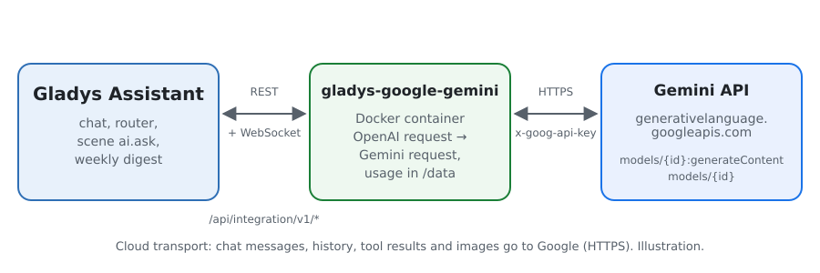
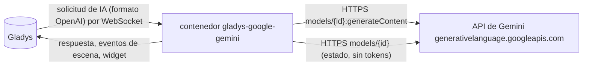
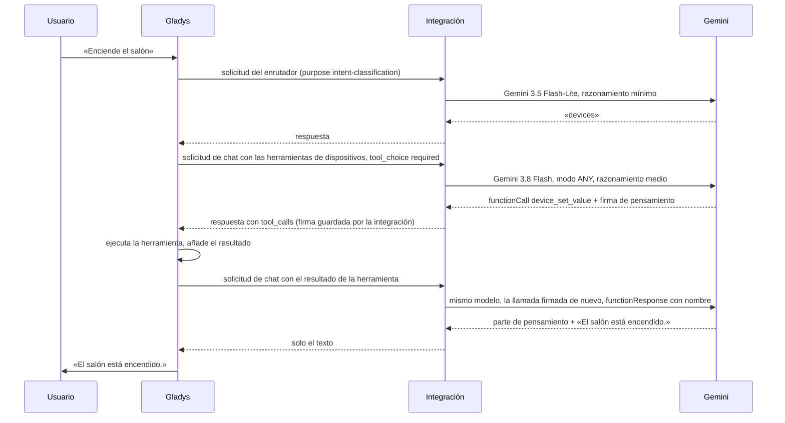
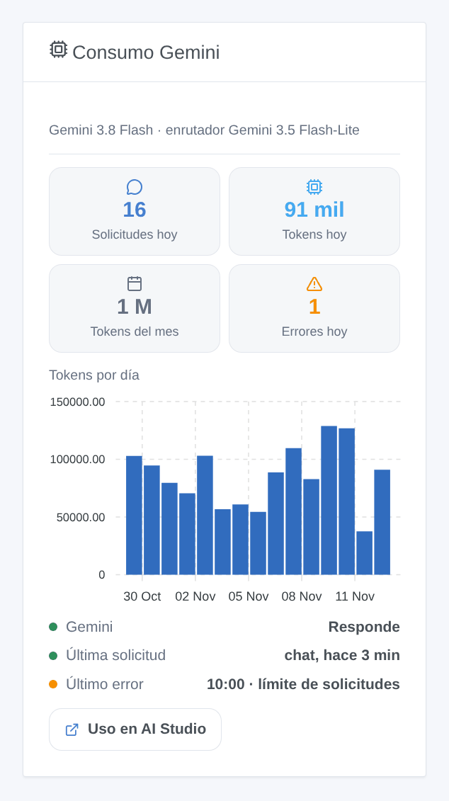

# Gladys Google Gemini

[English](README.md) · [Français](README.fr.md) · [Deutsch](README.de.md) · **Español**

[](LICENSE)
[](https://github.com/William-De71/gladys-google-gemini/releases)
[](https://github.com/William-De71/gladys-google-gemini/actions/workflows/release.yml)
[](https://gladysassistant.com)



Integración externa de [Gladys Assistant](https://gladysassistant.com) que hace funcionar el asistente de Gladys con **Google Gemini**, a través de la API oficial de Gemini y su propia clave de API de Google AI Studio. Una vez elegido en Ajustes → Inteligencia artificial, Gemini responde al chat, controla sus dispositivos, crea escenas, responde a la acción de escena «preguntar a la IA» y redacta el resumen semanal — con o sin cuenta Gladys Plus, y el nivel gratuito basta para empezar.

Documentación de usuario: [English](docs/en.md) · [Français](docs/fr.md) · [Deutsch](docs/de.md) · [Español](docs/es.md).

No afiliada a Google. **Todavía no probada con una clave real de Gemini**: las solicitudes siguen la referencia REST oficial de la API de Gemini, y las pruebas se ejecutan contra una API falsa. Sus comentarios son bienvenidos.

## Funciones

- **Proveedor de IA** (`type: "ai"`, Gladys 5.3+): todas las solicitudes de IA de Gladys van a Gemini — el chat con sus llamadas a herramientas, el enrutador de intenciones, la acción de escena «preguntar a la IA», el resumen semanal.
- **Dos modelos**: un modelo de chat (Gemini 3.8 Flash por defecto) y un modelo de enrutador rápido (Gemini 3.5 Flash-Lite por defecto), o cualquier otro identificador de modelo de Gemini.
- **Nivel de razonamiento** del modelo del chat (mínimo, bajo, medio, alto), adaptado a lo que acepta cada modelo.
- **Firmas de pensamiento conservadas** entre los turnos de una conversación, como exigen Gemini 3 y posteriores para las llamadas a herramientas.
- **Desencadenantes de escena**: el asistente falla (clave rechazada, facturación o nivel gratuito, límite de solicitudes, modelo no disponible, API inaccesible) y vuelve a responder — una vez por fallo.
- **Widget de panel**: solicitudes y tokens del día y del mes, tokens por día durante 30 días, última respuesta y último error.
- Botón **Probar la conexión**; la pantalla de configuración indica si Google acepta la clave y los modelos.
- Solicitudes enviadas con el registro desactivado (`store: false`). Inglés, francés, alemán y español.

## Funcionamiento





Todo el bucle agéntico (prompts, herramientas, historial, redimensionado de imágenes) se queda en Gladys; la integración traduce cada solicitud y su respuesta:



Lo que gestiona la traducción: los mensajes de sistema a `systemInstruction`, los turnos a `contents` con los roles `user` y `model`, las llamadas a herramientas a partes `functionCall` (argumentos como objetos), los resultados de herramientas a partes `functionResponse` con el nombre de su llamada (Gladys no repite el nombre), las imágenes en data URL a `inlineData`, `tool_choice` a `functionCallingConfig` (`required` → `ANY`), el JSON Schema de las herramientas a `parametersJsonSchema`, las partes de pensamiento quitadas del texto, el consumo con el razonamiento contado como salida. Un 429 o un 5xx se reintenta mientras el tiempo de espera del núcleo lo permita (18 s para el enrutador, 110 s para el chat), respetando `Retry-After` y el `RetryInfo` de Google; una llamada de función mal formada se vuelve a pedir una vez.

**Firmas de pensamiento**: Gemini 3 y posteriores firman las partes que producen y rechazan (HTTP 400) un historial cuyas llamadas de función han perdido su firma. Gladys solo conserva los campos de OpenAI: la integración guarda por tanto las firmas en memoria, por identificador de llamada, durante seis horas, y las vuelve a poner. Una llamada que nunca ha visto (tras un reinicio, o un historial producido por otro proveedor) recibe el valor que Google documenta para ese caso, `skip_thought_signature_validator`.

### Transporte

`transports: ["cloud"]`: todo va a `generativelanguage.googleapis.com` por HTTPS, la clave en la cabecera `x-goog-api-key`. **Google ve cada mensaje del chat, el historial, las definiciones y resultados de las herramientas (el estado de los dispositivos que consulta) y las imágenes del chat**, y sus respuestas controlan sus dispositivos y escenas. Fuera del Espacio Económico Europeo, Suiza y el Reino Unido, Google puede usar las solicitudes del nivel gratuito para mejorar sus productos; en esos países, y en cualquier lugar con una cuenta de facturación, no lo hace. Gladys nunca recurre a Gladys Plus cuando Gemini falla: el chat dice qué ocurre. `/data` solo guarda los contadores del widget.

## Modelos

| Modelo                | Identificador de API    | Uso                                                                     | Razonamiento                            | Gratuito |
| --------------------- | ----------------------- | ----------------------------------------------------------------------- | --------------------------------------- | -------- |
| Gemini 3.8 Flash      | `gemini-3.8-flash`      | Chat (por defecto): el mejor del nivel gratuito (herramientas, escenas) | bajo, medio, alto                       | sí       |
| Gemini 4 Argon        | `gemini-4-argon`        | Chat: el más capaz                                                      | bajo, medio, alto                       | no       |
| Gemini 3.6 Flash      | `gemini-3.6-flash`      | Chat: el Flash anterior                                                 | de mínimo a alto                        | sí       |
| Gemini 3.5 Flash-Lite | `gemini-3.5-flash-lite` | Enrutador (por defecto): rápido, dentro de los 20 s que le da Gladys    | de mínimo a alto                        | sí       |
| Gemini 3.1 Flash-Lite | `gemini-3.1-flash-lite` | Enrutador; retirada prevista en mayo de 2027                            | de mínimo a alto                        | sí       |
| Otro modelo           | su identificador        | Un modelo más reciente, una versión preliminar: debe llamar a funciones | según lo pedido, se quita si se rechaza | —        |

Identificadores, niveles de razonamiento y niveles de servicio comprobados en la documentación de la API de Gemini el 2 de noviembre de 2026. Las versiones preliminares quedan fuera de las listas (cambian y desaparecen): use «Otro modelo».

## Escenas y widget



- **Desencadenante «Gemini: el asistente falla»**: variables `kind` (`auth`, `billing`, `rate_limit`, `model`, `unreachable`, `timeout`, `server`), `message`, `use`, `model`; filtro por tipo. Una solicitud rechazada (HTTP 400, respuesta detenida por los filtros de seguridad) solo le concierne a ella y no desencadena nada.
- **Desencadenante «Gemini: el asistente vuelve a responder»**: variable `down_minutes`.
- **Widget «Consumo Gemini»**: contado por la integración a partir del `usageMetadata` de cada respuesta, razonamiento incluido; las solicitudes hechas fuera de Gladys con la misma clave no están incluidas. Google AI Studio sigue siendo la referencia para la factura.
- **Sin acción de búsqueda web**: las condiciones de la fundamentación con la Búsqueda de Google exigen mostrar las sugerencias de búsqueda de Google con cada respuesta fundamentada, y prohíben modificarla; una escena que la lee en voz alta o la envía por SMS no puede hacerlo.

Ejemplos:

- _Cuando el asistente falla_ (tipo `rate_limit` o `billing`) → enviar un mensaje de Telegram al administrador con `{{triggerEvent.data.message}}`.
- _Cuando el asistente vuelve a responder_ → enviar «Gemini ha vuelto tras `{{triggerEvent.data.down_minutes}}` min».

## Requisitos previos

- Gladys Assistant **5.3.0** o posterior (proveedores de IA); las instancias más antiguas no pueden instalar la integración.
- Una cuenta de Google y una clave de API de Gemini de [Google AI Studio](https://aistudio.google.com/apikey).

### Niveles y límites

- **Nivel gratuito**: todos los modelos de las listas salvo Gemini 4 Argon, con límites bajos por minuto y por día, por proyecto (se reinician a medianoche, hora del Pacífico), visibles en AI Studio → Rate limit.
- **Nivel de pago** (una cuenta de facturación vinculada al proyecto): límites más altos que crecen con el gasto, Gemini 4 Argon, facturación por token (tokens de razonamiento facturados como salida). Los precios están en la página de precios de la API de Gemini.
- Un turno de chat de Gladys hace al menos dos solicitudes (enrutador y luego chat), más cuando se llaman herramientas: un 429 se reintenta dentro del tiempo que Gladys espera; una espera más larga pedida por Google falla al instante con su motivo.
- Las condiciones de Google reservan la API de Gemini a los desarrolladores que construyen con ella; en el Espacio Económico Europeo, Suiza y el Reino Unido exigen servicios de pago cuando una aplicación se ofrece a otros usuarios. Léalas para su uso.

## Instalación

- **Desde la tienda**: Integraciones → Google Gemini → Instalar.
- **Desde la URL del repositorio**: Integraciones → integración externa → `https://github.com/William-De71/gladys-google-gemini`.
- **Modo desarrollador**: ejecute `npm start` con las variables que da Gladys (ver Desarrollo).

## Configuración

| Campo o botón                    | Por defecto           | Significado                                                            |
| -------------------------------- | --------------------- | ---------------------------------------------------------------------- |
| Clave de API de Gemini           | —                     | Obligatoria, secreta: nunca se vuelve a mostrar ni se registra         |
| Modelo del chat                  | Gemini 3.8 Flash      | Chat, creación de escenas, resumen semanal                             |
| Modelo del enrutador             | Gemini 3.5 Flash-Lite | Clasifica cada mensaje antes de la respuesta, en menos de 20 s         |
| Identificador del otro modelo    | —                     | Se usa cuando un modelo está en «Otro modelo»                          |
| Razonamiento                     | medio                 | Del modelo del chat; el enrutador usa el más bajo que acepta su modelo |
| Longitud máxima de una respuesta | 16000 tokens          | Razonamiento incluido; auméntela si los registros indican max_tokens   |
| Probar la conexión               | —                     | Una respuesta corta de cada modelo, con su tiempo (algunos tokens)     |

## Uso

1. En Gladys (Integraciones → Google Gemini → Configuración): pegue la clave de API, elija los modelos y pulse **Probar la conexión**.
2. Ajustes → **Inteligencia artificial**: elija **Google Gemini** como proveedor.
3. Hable con Gladys en el chat; añada el widget a un panel; use los desencadenantes en sus escenas.

## Desarrollo

```bash
npm install
npm test                       # node --test, una API de Gemini falsa en 127.0.0.1, nunca la red
npm run lint                   # ESLint
npm run format:check           # Prettier
npx github:GladysAssistant/integration-store . --skip-image-check
scripts/build-cover.sh         # cover.jpg a partir de docs/assets/cover.svg
docs/illustrations/render.sh   # docs/assets/widgets.<lang>.png
```

En local, el SDK lee `GLADYS_HOST_API_URL`, `GLADYS_INTEGRATION_TOKEN` y `GLADYS_INTEGRATION_SELECTOR` (que Gladys da en modo desarrollador), y la integración lee `TZ`. `DEBUG=gladys-integration-sdk` muestra los registros del SDK.

Las pruebas cubren el cliente HTTP (errores, reintentos, plazos), la traducción en ambos sentidos (`validateAiCompletion` del SDK), las firmas de pensamiento, el gestor del chat (modelos por uso, razonamiento, parámetro rechazado, llamadas mal formadas, filtros), los desencadenantes, los contadores, el widget (`validateWidgetContent`), el manifiesto, los cuatro idiomas, el script de release y toda la integración contra el Gladys falso del SDK. `test/structure.test.js` congela todas las claves que guardan los usuarios.

## Proceso de release


Cada fusión en `main` lanza la CI y calcula la versión a partir de los [Conventional Commits](https://www.conventionalcommits.org/) desde la última etiqueta: `feat` → menor, `fix` / `perf` → parche, `!` o `BREAKING CHANGE` → mayor (una menor antes de 1.0.0); `docs`, `chore`, `ci`, `test`, `style`, `refactor`, `build` solos no publican nada. Se genera la sección del changelog, se sube la etiqueta, se construye la imagen multiarquitectura, luego `main` recibe el commit de release, se crea la GitHub Release y un último job comprueba la imagen pública, el validador de la tienda y el topic.

- El título de la pull request se convierte en el commit squash y luego en la línea del changelog: escríbalo en inglés, para el usuario (`pr-title.yml` lo comprueba). Nunca edite `CHANGELOG.md` a mano.
- 1.0.0 es una decisión: Actions → Release → Run workflow con `release-as: 1.0.0`. `dry-run` muestra la versión y las notas sin publicar nada.
- **Rama protegida**: la release sube su commit a `main` con `GITHUB_TOKEN`. El ruleset `protect-main` (ni borrado ni force-push) lo deja pasar; una regla más estricta (pull request obligatoria, status checks) necesitaría GitHub Actions en su lista de omisión, o una GitHub App.
- Tras la primera release, haga público el paquete `ghcr.io` (Package settings → Change visibility), o Gladys no podrá descargarlo.

## Solución de problemas

Vea [docs/es.md](docs/es.md#solución-de-problemas). Informe de los problemas con las versiones de Gladys y de la integración, los modelos elegidos, su nivel y su país, y el mensaje de **Probar la conexión**. Nunca pegue su clave de API.

## Contribuir

Las issues y pull requests son bienvenidas, sobre todo de personas con una clave de Gemini: una solicitud que falla (sin la clave) ayuda mucho. Ejecute `npm run format:check && npm run lint && npm test` antes de abrir una pull request, y no cambie ninguna clave guardada (vea [CLAUDE.md](CLAUDE.md)).

## Seguridad

Vea [SECURITY.md](SECURITY.md): informe de las vulnerabilidades en privado. La clave de API es un campo `secret`: nunca se registra, nunca se escribe en `/data`, solo se envía a `generativelanguage.googleapis.com` por HTTPS, en una cabecera.

## Capturas pendientes

Las imágenes anteriores son ilustraciones, no capturas de pantalla. Las capturas reales irán en `docs/assets/screenshots/` (PNG, 1280 × 800): `configuration.png` (la configuración con su estado), `ai-settings.png` (Gemini elegido en Ajustes → Inteligencia artificial), `chat.png` (un chat que enciende un dispositivo).

## Licencia

[Licencia Apache 2.0](LICENSE) — vea también [NOTICE](NOTICE). Google, Gemini y Google AI Studio son marcas de Google LLC; este proyecto no está afiliado a Google ni cuenta con su respaldo o patrocinio. Gracias a la documentación y al SDK de Gladys, y a la documentación de la API de Gemini.
