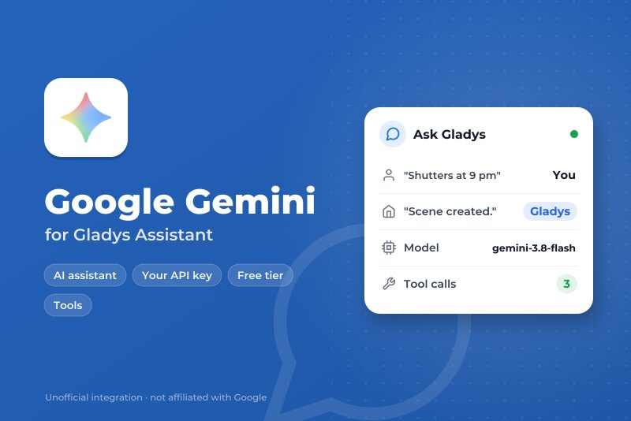
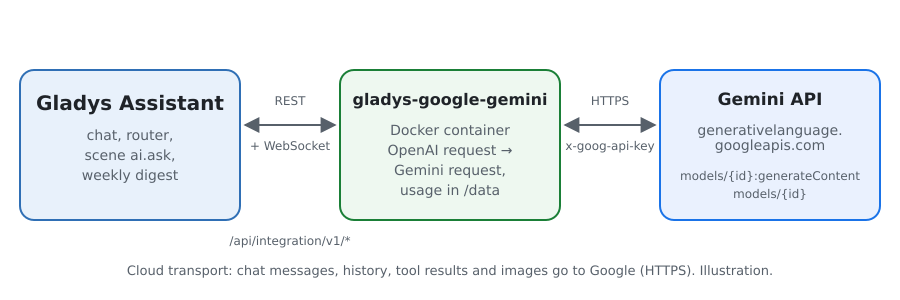
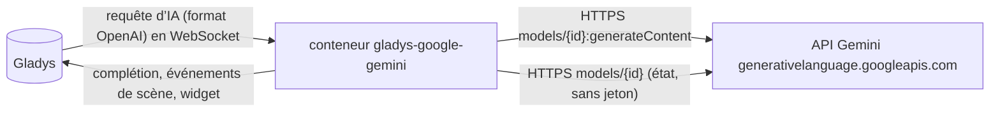
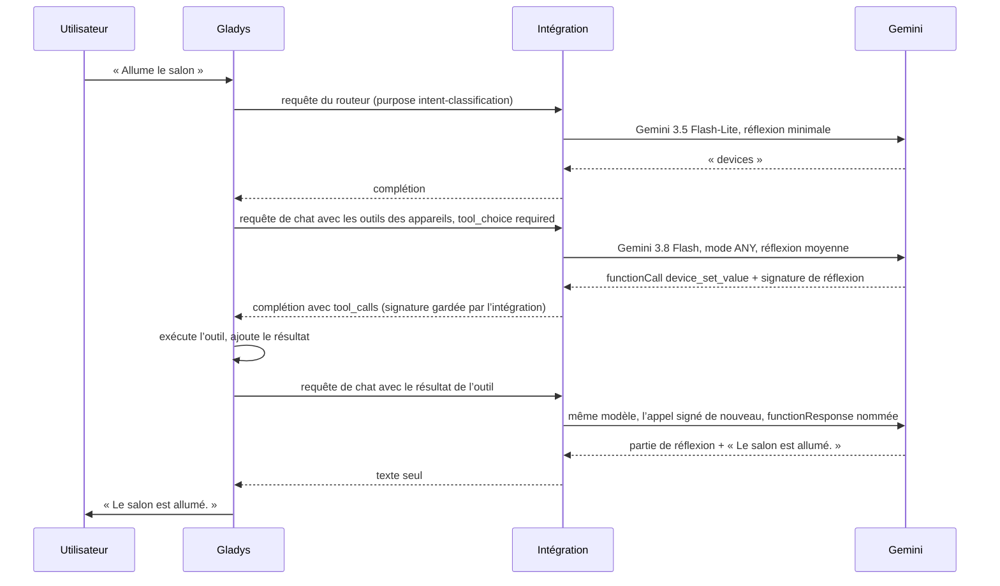
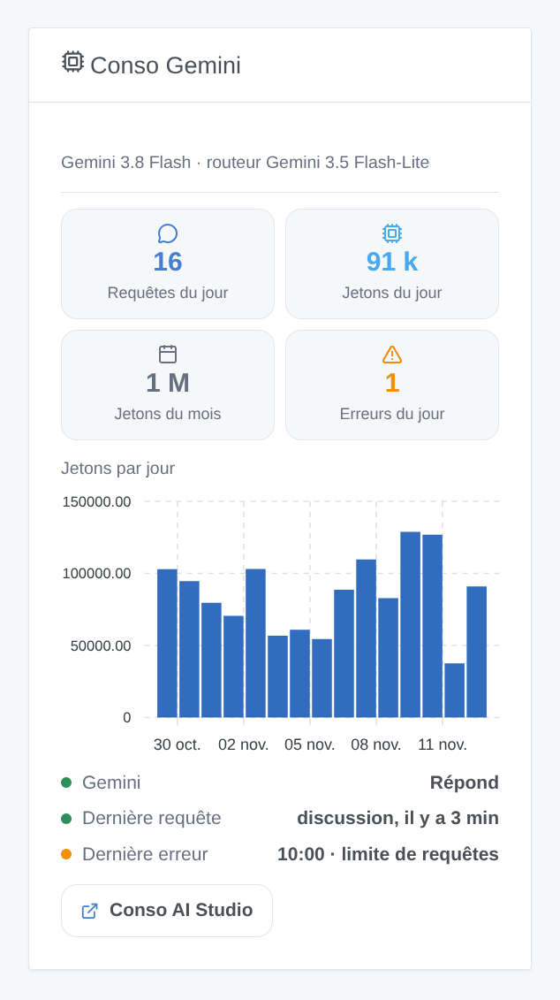

# Gladys Google Gemini

[English](README.md) · **Français** · [Deutsch](README.de.md) · [Español](README.es.md)

[](LICENSE)
[](https://github.com/William-De71/gladys-google-gemini/releases)
[](https://github.com/William-De71/gladys-google-gemini/actions/workflows/release.yml)
[](https://gladysassistant.com)



Intégration externe de [Gladys Assistant](https://gladysassistant.com) qui fait tourner l’assistant de Gladys sur **Google Gemini**, via l’API Gemini officielle et votre propre clé d’API Google AI Studio. Une fois choisi dans Paramètres → Intelligence artificielle, Gemini répond au chat, pilote vos appareils, crée des scènes, répond à l’action de scène « demander à l’IA » et rédige le résumé hebdomadaire — avec ou sans compte Gladys Plus, et l’offre gratuite suffit pour commencer.

Documentation utilisateur : [English](docs/en.md) · [Français](docs/fr.md) · [Deutsch](docs/de.md) · [Español](docs/es.md).

Non affiliée à Google. **Pas encore testée avec une vraie clé Gemini** : les requêtes suivent la référence REST officielle de l’API Gemini, et les tests tournent contre une fausse API. Vos retours sont les bienvenus.

## Fonctionnalités

- **Fournisseur d’IA** (`type: "ai"`, Gladys 5.3+) : toutes les requêtes d’IA de Gladys partent vers Gemini — le chat et ses appels d’outils, le routeur d’intention, l’action de scène « demander à l’IA », le résumé hebdomadaire.
- **Deux modèles** : un modèle de chat (Gemini 3.8 Flash par défaut) et un modèle de routeur rapide (Gemini 3.5 Flash-Lite par défaut), ou tout autre identifiant de modèle Gemini.
- **Niveau de réflexion** du modèle du chat (minimale, faible, moyenne, élevée), adapté à ce que chaque modèle accepte.
- **Signatures de réflexion conservées** entre les tours d’une conversation, comme Gemini 3 et suivants l’exigent pour les appels d’outils.
- **Déclencheurs de scène** : l’assistant est en erreur (clé refusée, facturation ou offre gratuite, limite de requêtes, modèle indisponible, API injoignable) et répond de nouveau — une fois par panne.
- **Widget de tableau de bord** : requêtes et jetons du jour et du mois, jetons par jour sur 30 jours, dernière réponse et dernière erreur.
- Bouton **Tester la connexion** ; l’écran de configuration indique si Google accepte la clé et les modèles.
- Requêtes envoyées avec la journalisation coupée (`store: false`). Anglais, français, allemand et espagnol.

## Fonctionnement





Toute la boucle agentique (prompts, outils, historique, redimensionnement des images) reste dans Gladys ; l’intégration traduit chaque requête et sa réponse :



Ce que gère la traduction : les messages système vers `systemInstruction`, les tours vers `contents` avec les rôles `user` et `model`, les appels d’outils vers des parties `functionCall` (arguments en objets), les résultats d’outils vers des parties `functionResponse` nommées d’après leur appel (Gladys ne répète pas le nom), les images en data URL vers `inlineData`, `tool_choice` vers `functionCallingConfig` (`required` → `ANY`), le JSON Schema des outils vers `parametersJsonSchema`, les parties de réflexion retirées du texte, la consommation avec la réflexion comptée en sortie. Une 429 ou une 5xx est retentée tant que le temps d’attente du cœur le permet (18 s pour le routeur, 110 s pour le chat), en respectant `Retry-After` et le `RetryInfo` de Google ; un appel de fonction mal formé est redemandé une fois.

**Signatures de réflexion** : Gemini 3 et suivants signent les parties qu’ils produisent et refusent (HTTP 400) un historique dont les appels de fonction ont perdu leur signature. Gladys ne garde que les champs OpenAI : l’intégration mémorise donc les signatures, en mémoire, par identifiant d’appel, pendant six heures, et les remet en place. Un appel qu’elle n’a jamais vu (après un redémarrage, ou un historique produit par un autre fournisseur) reçoit la valeur que Google documente pour ce cas, `skip_thought_signature_validator`.

### Transport

`transports: ["cloud"]` : tout part vers `generativelanguage.googleapis.com` en HTTPS, la clé dans l’en-tête `x-goog-api-key`. **Google voit chaque message du chat, l’historique, les définitions et résultats des outils (l’état des appareils qu’il consulte) et les images du chat**, et ses réponses pilotent vos appareils et vos scènes. Hors de l’Espace économique européen, de la Suisse et du Royaume-Uni, Google peut utiliser les requêtes de l’offre gratuite pour améliorer ses produits ; dans ces pays, et partout avec un compte de facturation, il ne le fait pas. Gladys ne se replie jamais sur Gladys Plus quand Gemini échoue : le chat dit ce qui ne va pas. `/data` ne garde que les compteurs du widget.

## Modèles

| Modèle                | Identifiant d’API       | Usage                                                              | Réflexion                         | Offre gratuite |
| --------------------- | ----------------------- | ------------------------------------------------------------------ | --------------------------------- | -------------- |
| Gemini 3.8 Flash      | `gemini-3.8-flash`      | Chat (défaut) : le meilleur de l’offre gratuite (outils, scènes)   | faible, moyenne, élevée           | oui            |
| Gemini 4 Argon        | `gemini-4-argon`        | Chat : le plus capable                                             | faible, moyenne, élevée           | non            |
| Gemini 3.6 Flash      | `gemini-3.6-flash`      | Chat : le Flash précédent                                          | de minimale à élevée              | oui            |
| Gemini 3.5 Flash-Lite | `gemini-3.5-flash-lite` | Routeur (défaut) : rapide, sous les 20 s que Gladys lui laisse     | de minimale à élevée              | oui            |
| Gemini 3.1 Flash-Lite | `gemini-3.1-flash-lite` | Routeur ; arrêt prévu en mai 2027                                  | de minimale à élevée              | oui            |
| Autre modèle          | votre identifiant       | Un modèle plus récent, une préversion : il doit appeler des outils | comme demandé, retirée si refusée | —              |

Identifiants, niveaux de réflexion et offres vérifiés dans la documentation de l’API Gemini le 2 novembre 2026. Les préversions sont laissées hors des listes (elles bougent et disparaissent) : utilisez « Autre modèle ».

## Scènes et widget



- **Déclencheur « Gemini : l’assistant est en erreur »** : variables `kind` (`auth`, `billing`, `rate_limit`, `model`, `unreachable`, `timeout`, `server`), `message`, `use`, `model` ; filtre par type. Une requête refusée (HTTP 400, réponse arrêtée par les filtres de sécurité) ne concerne qu’elle et ne déclenche rien.
- **Déclencheur « Gemini : l’assistant répond de nouveau »** : variable `down_minutes`.
- **Widget « Conso Gemini »** : compté par l’intégration à partir du `usageMetadata` de chaque réponse, réflexion comprise ; les requêtes faites hors de Gladys avec la même clé n’y sont pas. Google AI Studio reste la référence pour la facture.
- **Pas d’action de recherche web** : les conditions de l’ancrage dans la recherche Google imposent d’afficher les suggestions de recherche de Google avec chaque réponse ancrée, et interdisent de la modifier ; une scène qui la lit à voix haute ou l’envoie par SMS ne le peut pas.

Exemples :

- _Quand l’assistant est en erreur_ (type `rate_limit` ou `billing`) → envoyer un message Telegram à l’administrateur avec `{{triggerEvent.data.message}}`.
- _Quand l’assistant répond de nouveau_ → envoyer « Gemini est revenu après `{{triggerEvent.data.down_minutes}}` min ».

## Prérequis

- Gladys Assistant **5.3.0** ou plus récent (fournisseurs d’IA) ; les instances plus anciennes ne peuvent pas installer l’intégration.
- Un compte Google et une clé d’API Gemini depuis [Google AI Studio](https://aistudio.google.com/apikey).

### Offres et limites

- **Offre gratuite** : tous les modèles des listes sauf Gemini 4 Argon, avec des limites basses par minute et par jour, par projet (remises à zéro à minuit, heure du Pacifique), visibles dans AI Studio → Rate limit.
- **Offre payante** (un compte de facturation lié au projet) : limites plus hautes qui grandissent avec les dépenses, Gemini 4 Argon, facturation au jeton (jetons de réflexion facturés en sortie). Les prix sont sur la page de tarifs de l’API Gemini.
- Un tour de chat de Gladys fait au moins deux requêtes (routeur, puis chat), davantage quand des outils sont appelés : une 429 est retentée dans le temps que Gladys attend, une attente plus longue demandée par Google échoue tout de suite avec sa raison.
- Les conditions de Google réservent l’API Gemini aux développeurs qui construisent avec ; dans l’Espace économique européen, en Suisse et au Royaume-Uni, elles demandent les services payants quand une application est proposée à d’autres utilisateurs. Lisez-les pour votre usage.

## Installation

- **Depuis le store** : Intégrations → Google Gemini → Installer.
- **Depuis l’URL du dépôt** : Intégrations → intégration externe → `https://github.com/William-De71/gladys-google-gemini`.
- **Mode développeur** : lancez `npm start` avec les variables fournies par Gladys (voir Développement).

## Configuration

| Champ ou bouton                 | Défaut                | Rôle                                                                       |
| ------------------------------- | --------------------- | -------------------------------------------------------------------------- |
| Clé d’API Gemini                | —                     | Obligatoire, secrète : plus jamais affichée, jamais journalisée            |
| Modèle du chat                  | Gemini 3.8 Flash      | Chat, création de scènes, résumé hebdomadaire                              |
| Modèle du routeur               | Gemini 3.5 Flash-Lite | Trie chaque message avant la réponse, en moins de 20 s                     |
| Identifiant de l’autre modèle   | —                     | Utilisé quand un modèle est réglé sur « Autre modèle »                     |
| Réflexion                       | moyenne               | Du modèle du chat ; le routeur prend la plus faible que son modèle accepte |
| Longueur maximale d’une réponse | 16000 jetons          | Réflexion comprise ; à augmenter si les journaux signalent max_tokens      |
| Tester la connexion             | —                     | Une courte réponse de chaque modèle, avec son temps (quelques jetons)      |

## Utilisation

1. Dans Gladys (Intégrations → Google Gemini → Configuration) : collez la clé d’API, choisissez les modèles ; appuyez sur **Tester la connexion**.
2. Paramètres → **Intelligence artificielle** : choisissez **Google Gemini** comme fournisseur.
3. Parlez à Gladys dans le chat ; ajoutez le widget à un tableau de bord ; utilisez les déclencheurs dans vos scènes.

## Développement

```bash
npm install
npm test                       # node --test, une fausse API Gemini sur 127.0.0.1, jamais le réseau
npm run lint                   # ESLint
npm run format:check           # Prettier
npx github:GladysAssistant/integration-store . --skip-image-check
scripts/build-cover.sh         # cover.jpg depuis docs/assets/cover.svg
docs/illustrations/render.sh   # docs/assets/widgets.<lang>.png
```

En local, le SDK lit `GLADYS_HOST_API_URL`, `GLADYS_INTEGRATION_TOKEN` et `GLADYS_INTEGRATION_SELECTOR` (fournies par Gladys en mode développeur), et l’intégration lit `TZ`. `DEBUG=gladys-integration-sdk` affiche les journaux du SDK.

Les tests couvrent le client HTTP (erreurs, relances, délais), la conversion dans les deux sens (`validateAiCompletion` du SDK), les signatures de réflexion, le gestionnaire de chat (modèles par usage, réflexion, paramètre refusé, appels mal formés, filtres), les déclencheurs, les compteurs, le widget (`validateWidgetContent`), le manifeste, les quatre langues, le script de release, et toute l’intégration contre le faux Gladys du SDK. `test/structure.test.js` fige toutes les clés que les utilisateurs enregistrent.

## Processus de release


Chaque fusion sur `main` lance la CI, puis calcule la version d’après les [Conventional Commits](https://www.conventionalcommits.org/) depuis le dernier tag : `feat` → mineure, `fix` / `perf` → correctif, `!` ou `BREAKING CHANGE` → majeure (une mineure avant 1.0.0) ; `docs`, `chore`, `ci`, `test`, `style`, `refactor`, `build` seuls ne publient rien. La section du changelog est générée, le tag poussé, l’image multi-architecture construite, puis `main` reçoit le commit de release, la GitHub Release est créée et un dernier job vérifie l’image publique, le validateur du store et le topic.

- Le titre de la pull request devient le commit squash, puis la ligne du changelog : écrivez-le en anglais, pour l’utilisateur (`pr-title.yml` le vérifie). N’éditez jamais `CHANGELOG.md` à la main.
- 1.0.0 est une décision : Actions → Release → Run workflow avec `release-as: 1.0.0`. `dry-run` affiche la version et les notes sans rien publier.
- **Branche protégée** : la release pousse son commit sur `main` avec `GITHUB_TOKEN`. Le ruleset `protect-main` (ni suppression ni force-push) le laisse passer ; une règle plus stricte (pull request obligatoire, status checks) demanderait GitHub Actions dans sa liste de contournement, ou une GitHub App.
- Après la première release, rendez public le package `ghcr.io` (Package settings → Change visibility), sinon Gladys ne peut pas le télécharger.

## Dépannage

Voir [docs/fr.md](docs/fr.md#dépannage). Signalez les problèmes avec les versions de Gladys et de l’intégration, les modèles choisis, votre offre et votre pays, et le message de **Tester la connexion**. Ne collez jamais votre clé d’API.

## Contribuer

Issues et pull requests bienvenues, surtout de la part de personnes qui ont une clé Gemini : une requête qui échoue (sans la clé) aide beaucoup. Lancez `npm run format:check && npm run lint && npm test` avant d’ouvrir une pull request, et ne changez aucune clé enregistrée (voir [CLAUDE.md](CLAUDE.md)).

## Sécurité

Voir [SECURITY.md](SECURITY.md) : signalez les vulnérabilités en privé. La clé d’API est un champ `secret` : jamais journalisée, jamais écrite dans `/data`, envoyée seulement à `generativelanguage.googleapis.com` en HTTPS, dans un en-tête.

## Captures à venir

Les images ci-dessus sont des illustrations, pas des captures d’écran. Les vraies captures iront dans `docs/assets/screenshots/` (PNG, 1280 × 800) : `configuration.png` (la configuration avec son état), `ai-settings.png` (Gemini choisi dans Paramètres → Intelligence artificielle), `chat.png` (un chat qui allume un appareil).

## Licence

[Licence Apache 2.0](LICENSE) — voir aussi [NOTICE](NOTICE). Google, Gemini et Google AI Studio sont des marques de Google LLC ; ce projet n’est ni affilié à Google, ni approuvé ou soutenu par Google. Merci à la documentation et au SDK de Gladys, et à la documentation de l’API Gemini.
