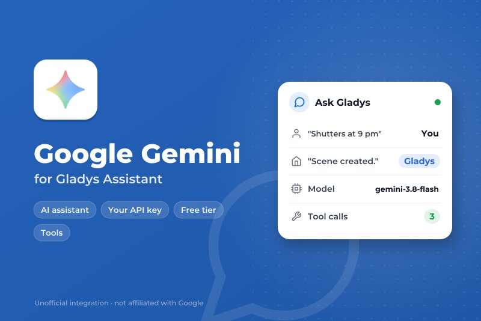
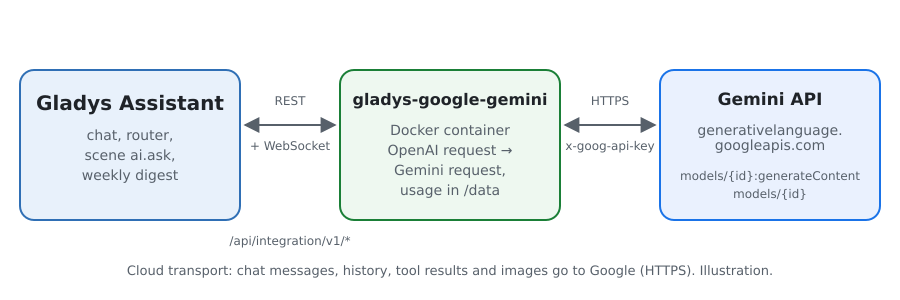
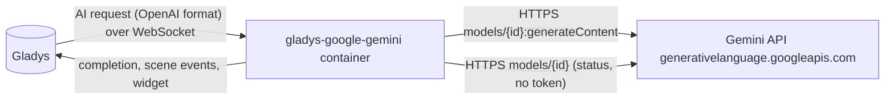
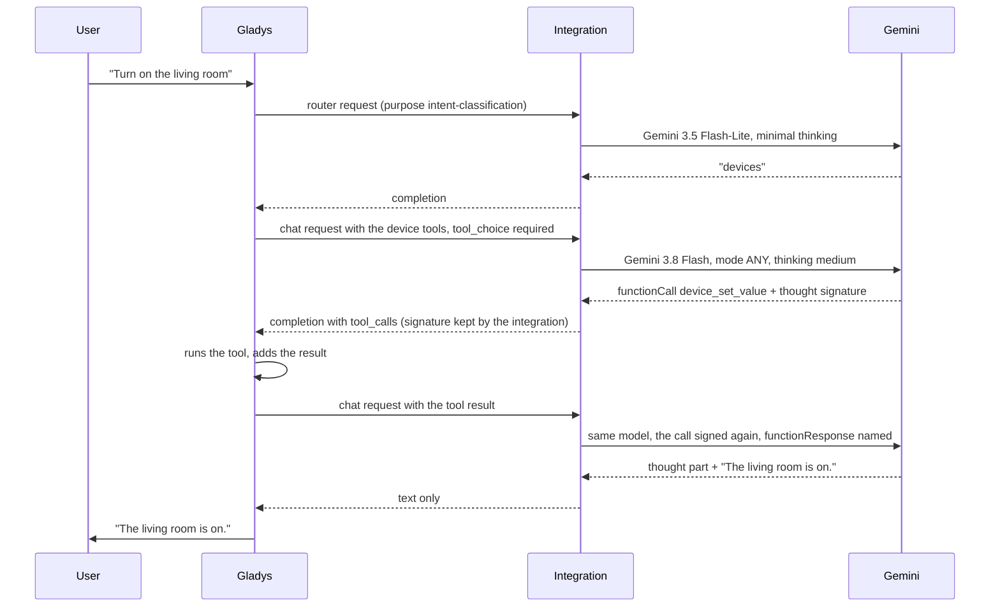
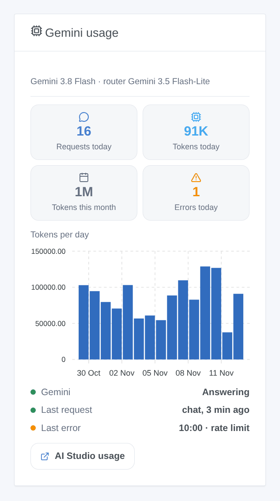

# Gladys Google Gemini

**English** · [Français](README.fr.md) · [Deutsch](README.de.md) · [Español](README.es.md)

[](LICENSE)
[](https://github.com/William-De71/gladys-google-gemini/releases)
[](https://github.com/William-De71/gladys-google-gemini/actions/workflows/release.yml)
[](https://gladysassistant.com)



[Gladys Assistant](https://gladysassistant.com) external integration that runs the assistant of Gladys on **Google Gemini**, through the official Gemini API and your own API key from Google AI Studio. Once selected in Settings → Artificial Intelligence, Gemini answers the chat, controls your devices, creates scenes, answers the "ask the AI" scene action and writes the weekly digest — with or without a Gladys Plus account, and the free tier is enough to start.

User documentation: [English](docs/en.md) · [Français](docs/fr.md) · [Deutsch](docs/de.md) · [Español](docs/es.md).

Not affiliated with Google. **Not tested with a real Gemini key yet**: the requests follow the official REST reference of the Gemini API, and the tests run against a fake API. Feedback welcome.

## Features

- **AI provider** (`type: "ai"`, Gladys 5.3+): every AI request of Gladys goes to Gemini — the chat with its tool calls, the intent router, the scene "ask the AI" action, the weekly digest.
- **Two models**: a chat model (Gemini 3.8 Flash by default) and a fast router model (Gemini 3.5 Flash-Lite by default), or any other Gemini model id.
- **Thinking level** of the chat model (minimal, low, medium, high), adapted to what each model accepts.
- **Thought signatures kept** between the turns of a conversation, as Gemini 3 and later require for tool calls.
- **Scene triggers**: the assistant fails (key refused, billing or free tier, rate limit, model unavailable, API unreachable) and answers again — once per failure.
- **Dashboard widget**: requests and tokens of the day and of the month, tokens per day over 30 days, last answer and last error.
- **Test the connection** button; the configuration screen shows whether Google accepts the key and the models.
- Requests sent with logging off (`store: false`). English, French, German and Spanish.

## How it works





The whole agentic loop (prompts, tools, history, image resizing) stays in Gladys; the integration translates each request and its answer:



What the translation handles: system messages to `systemInstruction`, turns to `contents` with the roles `user` and `model`, tool calls to `functionCall` parts (arguments as objects), tool results to `functionResponse` parts named after their call (Gladys does not repeat the name), images from data URLs to `inlineData`, `tool_choice` to `functionCallingConfig` (`required` → `ANY`), the JSON Schema of the tools to `parametersJsonSchema`, thought parts removed from the text, the usage with thinking counted as output. A 429 or a 5xx is retried while the time the core waits allows it (18 s for the router, 110 s for the chat), honouring `Retry-After` and Google's `RetryInfo`; a malformed function call is asked again once.

**Thought signatures**: Gemini 3 and later sign the parts they produce and refuse (HTTP 400) a history whose function calls lost their signature. Gladys only keeps the OpenAI fields, so the integration remembers the signatures in memory, by tool call id, for six hours, and puts them back. A call it never saw (after a restart, or a history made by another provider) gets the value Google documents for that case, `skip_thought_signature_validator`.

### Transport

`transports: ["cloud"]`: everything goes to `generativelanguage.googleapis.com` over HTTPS, the key in the `x-goog-api-key` header. **Google sees every chat message, the history, the tool definitions and results (the state of the devices it reads) and the chat images**, and its answers drive your devices and scenes. Outside the European Economic Area, Switzerland and the United Kingdom, Google may use the requests of the free tier to improve its products; in those countries, and everywhere with a billing account, it does not. Gladys never falls back to Gladys Plus when Gemini fails: the chat says what is wrong. `/data` only keeps the usage counters of the widget.

## Models

| Model                 | API id                  | Use                                                            | Thinking                     | Free tier |
| --------------------- | ----------------------- | -------------------------------------------------------------- | ---------------------------- | --------- |
| Gemini 3.8 Flash      | `gemini-3.8-flash`      | Chat (default): the best of the free tier for tools and scenes | low, medium, high            | yes       |
| Gemini 4 Argon        | `gemini-4-argon`        | Chat: the most capable                                         | low, medium, high            | no        |
| Gemini 3.6 Flash      | `gemini-3.6-flash`      | Chat: the previous Flash                                       | minimal to high              | yes       |
| Gemini 3.5 Flash-Lite | `gemini-3.5-flash-lite` | Router (default): fast, under the 20 s Gladys gives it         | minimal to high              | yes       |
| Gemini 3.1 Flash-Lite | `gemini-3.1-flash-lite` | Router; shutdown planned in May 2027                           | minimal to high              | yes       |
| Other model           | your id                 | A newer model, a preview: it must call functions               | as asked, dropped if refused | —         |

Ids, thinking levels and tiers checked in the Gemini API documentation on 2 November 2026. Preview models are left out of the lists (they move and vanish); use "Other model" for them.

## Scenes and widget



- **Trigger "Gemini: the assistant fails"**: variables `kind` (`auth`, `billing`, `rate_limit`, `model`, `unreachable`, `timeout`, `server`), `message`, `use`, `model`; filter by kind. A refused request (HTTP 400, an answer stopped by the safety filters) is about that request only and starts nothing.
- **Trigger "Gemini: the assistant answers again"**: variable `down_minutes`.
- **Widget "Gemini usage"**: counted by the integration from the `usageMetadata` of each answer, thinking included; requests made outside Gladys with the same key are not in it. Google AI Studio stays the reference for the bill.
- **No web search action**: the terms of Grounding with Google Search require showing Google's Search Suggestions with each grounded answer, and forbid changing it; a scene that reads it aloud or sends it by SMS cannot do that.

Examples:

- _When the assistant fails_ (kind `rate_limit` or `billing`) → send a Telegram message to the administrator with `{{triggerEvent.data.message}}`.
- _When the assistant answers again_ → send "Gemini is back after `{{triggerEvent.data.down_minutes}}` min".

## Requirements

- Gladys Assistant **5.3.0** or later (AI providers); older instances cannot install the integration.
- A Google account and a Gemini API key from [Google AI Studio](https://aistudio.google.com/apikey).

### Tiers and limits

- **Free tier**: every model of the lists but Gemini 4 Argon, with low limits per minute and per day, per project (reset at midnight Pacific time), shown in AI Studio → Rate limit.
- **Paid tier** (a billing account linked to the project): higher limits that grow with the spending, Gemini 4 Argon, billed per token (thinking tokens billed as output). Prices are on the Gemini API pricing page.
- A chat turn of Gladys makes at least two requests (router, then chat), more when tools are called: a 429 is retried within the time Gladys waits, a longer wait asked by Google fails at once with its reason.
- Google's terms reserve the Gemini API to developers building with it; in the European Economic Area, Switzerland and the United Kingdom they ask for paid services when an app is offered to other users. Read them for your use.

## Installation

- **From the store**: Integrations → Google Gemini → Install.
- **From the repository URL**: Integrations → external integration → `https://github.com/William-De71/gladys-google-gemini`.
- **Developer mode**: run `npm start` with the variables given by Gladys (see Development).

## Configuration

| Field or button       | Default               | Meaning                                                               |
| --------------------- | --------------------- | --------------------------------------------------------------------- |
| Gemini API key        | —                     | Required, a secret: never shown again, never logged                   |
| Chat model            | Gemini 3.8 Flash      | Chat, scene creation, weekly digest                                   |
| Router model          | Gemini 3.5 Flash-Lite | Sorts every message before the answer, within 20 s                    |
| Other model id        | —                     | Used when a model is set to "Other model"                             |
| Thinking              | medium                | Of the chat model; the router uses the least its model accepts        |
| Maximum answer length | 16000 tokens          | Thinking included; raise it if the logs say an answer hit max_tokens  |
| Test the connection   | —                     | One short answer from each model, with its time (spends a few tokens) |

## Usage

1. In Gladys (Integrations → Google Gemini → Configuration): paste the API key, choose the models; press **Test the connection**.
2. Settings → **Artificial Intelligence**: choose **Google Gemini** as the provider.
3. Talk to Gladys in the chat; add the widget to a dashboard; use the triggers in your scenes.

## Development

```bash
npm install
npm test                       # node --test, a fake Gemini API on 127.0.0.1, never the network
npm run lint                   # ESLint
npm run format:check           # Prettier
npx github:GladysAssistant/integration-store . --skip-image-check
scripts/build-cover.sh         # cover.jpg from docs/assets/cover.svg
docs/illustrations/render.sh   # docs/assets/widgets.<lang>.png
```

Locally, the SDK reads `GLADYS_HOST_API_URL`, `GLADYS_INTEGRATION_TOKEN` and `GLADYS_INTEGRATION_SELECTOR` (given by Gladys in developer mode), and the integration reads `TZ`. `DEBUG=gladys-integration-sdk` shows the SDK logs.

The tests cover the HTTP client (errors, retries, deadlines), the conversion both ways (`validateAiCompletion` of the SDK), the thought signatures, the chat handler (models per purpose, thinking, refused parameter, malformed calls, filters), the triggers, the usage counters, the widget (`validateWidgetContent`), the manifest, the four languages, the release script, and the whole integration against the fake Gladys of the SDK. `test/structure.test.js` freezes every key users store.

## Release process


Every merge on `main` runs the CI, then computes the version from the [Conventional Commits](https://www.conventionalcommits.org/) since the last tag: `feat` → minor, `fix` / `perf` → patch, `!` or `BREAKING CHANGE` → major (a minor below 1.0.0); `docs`, `chore`, `ci`, `test`, `style`, `refactor`, `build` alone publish nothing. The changelog section is generated, the tag pushed, the multi-architecture image built, then `main` receives the release commit, the GitHub Release is created and a last job checks the public image, the store validator and the topic.

- The pull request title becomes the squash commit, then the changelog line: write it in English, for the user (`pr-title.yml` checks it). Never edit `CHANGELOG.md` by hand.
- 1.0.0 is a decision: Actions → Release → Run workflow with `release-as: 1.0.0`. `dry-run` shows the version and the notes without publishing.
- **Protected branch**: the release pushes its commit to `main` with `GITHUB_TOKEN`. The `protect-main` ruleset (no deletion, no force-push) lets it through; a stricter rule (pull request required, status checks) would need GitHub Actions in its bypass list, or a GitHub App.
- After the first release, make the `ghcr.io` package public (Package settings → Change visibility), or Gladys cannot pull it.

## Troubleshooting

See [docs/en.md](docs/en.md#troubleshooting). Report issues with the versions of Gladys and of the integration, the models chosen, your tier and country, and the message of **Test the connection**. Never paste your API key.

## Contributing

Issues and pull requests are welcome, especially from people with a Gemini key: a failing request (without the key) helps a lot. Run `npm run format:check && npm run lint && npm test` before opening a pull request, and keep every stored key unchanged (see [CLAUDE.md](CLAUDE.md)).

## Security

See [SECURITY.md](SECURITY.md): report vulnerabilities privately. The API key is a `secret` field: never logged, never written to `/data`, sent only to `generativelanguage.googleapis.com` over HTTPS, in a header.

## Screenshots to come

The images above are illustrations, not screenshots. Real screenshots will go in `docs/assets/screenshots/` (PNG, 1280 × 800): `configuration.png` (the configuration with its status), `ai-settings.png` (Gemini chosen in Settings → Artificial Intelligence), `chat.png` (a chat that switches a device on).

## License

[Apache License 2.0](LICENSE) — see also [NOTICE](NOTICE). Google, Gemini and Google AI Studio are trademarks of Google LLC; this project is not affiliated with, endorsed or sponsored by Google. Thanks to the Gladys documentation and SDK, and to the Gemini API documentation.
