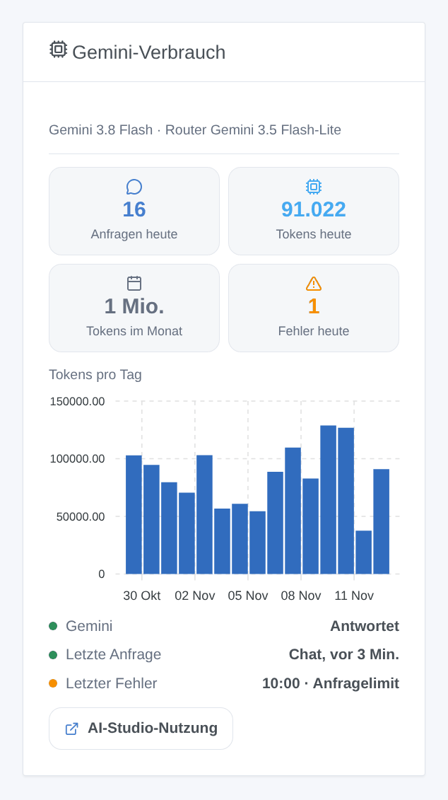

# Google Gemini

## Überblick

Diese Integration betreibt den Assistenten von Gladys mit **Google Gemini**, über die offizielle Gemini-API und deinen eigenen API-Schlüssel aus Google AI Studio. Sobald du sie unter **Einstellungen → Künstliche Intelligenz** auswählst, gehen alle KI-Anfragen von Gladys an Gemini: der Chat und die Geräte, die er steuert, die Szenen, die er erstellt, die Szenenaktion „die KI fragen“ und der Wochenrückblick. Sie funktioniert mit oder ohne Gladys-Plus-Konto, und der kostenlose Tarif der Gemini-API reicht für den Anfang.

Außerdem bringt sie zwei Szenenauslöser (der Assistent schlägt fehl, der Assistent antwortet wieder) und ein Dashboard-Widget zu deinem Verbrauch mit.

Nicht mit Google verbunden. Noch nicht mit einem echten Gemini-Schlüssel getestet: Rückmeldungen sind willkommen.

## Voraussetzungen

- Gladys Assistant 5.3.0 oder neuer.
- Ein Google-Konto und ein Gemini-API-Schlüssel: [Google AI Studio](https://aistudio.google.com/apikey), **Create API key**.
- **Kostenloser Tarif**: reicht für ein Zuhause, mit niedrigen Limits pro Minute und pro Tag (in AI Studio unter Rate limit sichtbar); Gemini 4 Argon gehört nicht dazu. **Mit einem Abrechnungskonto** (bezahlter Tarif): höhere Limits, alle Modelle, Abrechnung pro Token.
- **Deine Daten**: Außerhalb des Europäischen Wirtschaftsraums, der Schweiz und des Vereinigten Königreichs darf Google die Anfragen des kostenlosen Tarifs zur Verbesserung seiner Produkte nutzen, und Menschen können sie lesen. In diesen Ländern und überall mit einem Abrechnungskonto ist das nicht der Fall. Die Integration sendet jede Anfrage mit abgeschalteter Protokollierung (`store: false`).
- Was dein Zuhause verlässt: jede Chat-Nachricht, der Verlauf, die Werkzeuge, die Gladys anbietet, und ihre Ergebnisse (der Zustand der Geräte, die Gemini abfragt) sowie die Bilder des Chats gehen per HTTPS an Google. Die Antworten von Gemini steuern deine Geräte und erstellen Szenen.

## Konfiguration

| Feld oder Schaltfläche         | Standard              | Bedeutung                                                                              |
| ------------------------------ | --------------------- | -------------------------------------------------------------------------------------- |
| Gemini-API-Schlüssel           | —                     | Pflichtfeld. Wird nie wieder angezeigt und nie protokolliert                           |
| Chat-Modell                    | Gemini 3.8 Flash      | Beantwortet den Chat, erstellt Szenen, schreibt den Wochenrückblick                    |
| Router-Modell                  | Gemini 3.5 Flash-Lite | Ordnet jede Nachricht vor der Antwort ein und muss innerhalb von 20 Sekunden antworten |
| ID des anderen Modells         | —                     | Nur wenn ein Modell auf „Anderes Modell“ steht: die genaue API-ID (Werkzeugaufrufe)    |
| Nachdenken des Chat-Modells    | Mittel                | Mehr Nachdenken, bessere Szenen, langsamere und teurere Antworten                      |
| Maximale Antwortlänge (Tokens) | 16000                 | Nachdenken inklusive; Google empfiehlt 32768 für Gemini 4 Argon                        |
| Verbindung testen              | —                     | Eine kurze Antwort jedes Modells mit ihrer Dauer; verbraucht ein paar Tokens           |

Der Status der Konfigurationsseite zeigt, ob Google den Schlüssel und beide Modelle akzeptiert, ohne ein Token zu verbrauchen. Ein Modell lesen zu können beweist nicht, dass dein Projekt generieren darf (kostenloser Tarif nicht verfügbar, Abrechnung einzurichten): **Verbindung testen** prüft es.

## Verwendung

1. Integrationen → **Google Gemini** → Konfiguration: Füge den API-Schlüssel ein, behalte die Standardmodelle und drücke **Verbindung testen**.
2. Einstellungen → **Künstliche Intelligenz**: Wähle **Google Gemini**.
3. Sprich im Chat mit Gladys: „Schalte das Wohnzimmer ein“, „Wie warm ist es im Schlafzimmer?“, „Erstelle eine Szene, die bei Sonnenuntergang die Rollläden schließt“.

### Die Modelle wählen

- **Gemini 3.8 Flash** (Standard für den Chat): das leistungsfähigste Modell des kostenlosen Tarifs, gut beim Aufrufen von Werkzeugen und beim Erstellen von Szenen.
- **Gemini 4 Argon**: am leistungsfähigsten, nur für ein Projekt mit Abrechnung.
- **Gemini 3.6 Flash**: das vorherige Flash-Modell, weiterhin unterstützt.
- **Gemini 3.5 Flash-Lite** (Standard-Router) und **Gemini 3.1 Flash-Lite**: schnell und günstig; beim Erstellen von Szenen weniger zuverlässig. Google plant, 3.1 Flash-Lite im Mai 2027 abzuschalten.
- **Anderes Modell**: ein neueres Gemini-Modell oder eine Vorschau. Lehnt es die Nachdenkstufe ab, sendet die Integration es ab dann ohne.

Gemini denkt immer ein wenig nach: **Minimal** ist das Wenigste, und Gemini 3.8 Flash und Gemini 4 Argon beginnen bei **niedrig**. Der Router nutzt immer die niedrigste Stufe, die sein Modell akzeptiert.

### Dashboard-Widget

Das Widget **Gemini-Verbrauch** zeigt die Anfragen und Tokens des Tages, die Tokens des Monats, die Fehler des Tages, die Tokens pro Tag über 30 Tage, ob Gemini antwortet, die letzte Anfrage und den letzten Fehler. Es zählt, was Gladys gefragt hat, Nachdenken inklusive; Google AI Studio bleibt die Referenz für die Rechnung.

### Szenen

- **Auslöser „Gemini: Der Assistent schlägt fehl“**: einmal pro Ausfall (Schlüssel abgelehnt, Abrechnung oder kostenloser Tarif, Anfragelimit, Modell nicht verfügbar, API nicht erreichbar, zu langsam, Gemini-Fehler), mit Art, Meldung, Anfrage und Modell.
- **Auslöser „Gemini: Der Assistent antwortet wieder“**: die erste Antwort nach einem Ausfall, mit den Minuten des Ausfalls.

Beispiele: Wenn der Assistent wegen des Anfragelimits fehlschlägt, eine Telegram-Nachricht an den Administrator senden; wenn er wieder antwortet, eine weitere mit den Minuten des Ausfalls.

Es gibt keine Websuche-Aktion: Die Bedingungen der Fundierung mit der Google-Suche verlangen, die Suchvorschläge von Google mit jeder Antwort anzuzeigen, was eine Szenenbenachrichtigung nicht kann.

## Fehlerbehebung

- **„Google hat den API-Schlüssel abgelehnt“**: Kopiere den Schlüssel erneut aus Google AI Studio; ein gelöschter oder als geleakt gemeldeter Schlüssel ergibt dieselbe Meldung.
- **„Google führt … für dieses Projekt nicht aus“**: Der kostenlose Tarif ist für dieses Projekt nicht verfügbar, oder das Abrechnungskonto braucht Aufmerksamkeit; öffne Google AI Studio, Billing.
- **„Anfragelimit erreicht“**: Der kostenlose Tarif erlaubt wenige Anfragen pro Minute und pro Tag (pro Projekt, Zurücksetzung um Mitternacht pazifischer Zeit). Ein Chat-Durchgang macht mindestens zwei Anfragen. Warte, wähle einen leichteren Router oder verknüpfe ein Abrechnungskonto.
- **„… ist für diesen API-Schlüssel nicht verfügbar“**: Das Modell existiert nicht oder wurde abgeschaltet; wähle ein anderes.
- **Der Chat antwortet, ohne etwas zu tun**: Versuche Gemini 3.8 Flash mit mittlerem Nachdenken; die Flash-Lite-Modelle sind mit vielen Werkzeugen weniger zuverlässig.
- **„The answer was cut at max_tokens“** (englische Meldung): Erhöhe die maximale Antwortlänge oder senke das Nachdenken.
- **„Gemini stopped the answer (SAFETY)“** (englische Meldung): Die Filter von Google haben die Anfrage oder die Antwort blockiert; formuliere sie um.
- Protokolle: Einstellungen → Supervision, Protokolle der Integration. Teile niemals deinen API-Schlüssel.
