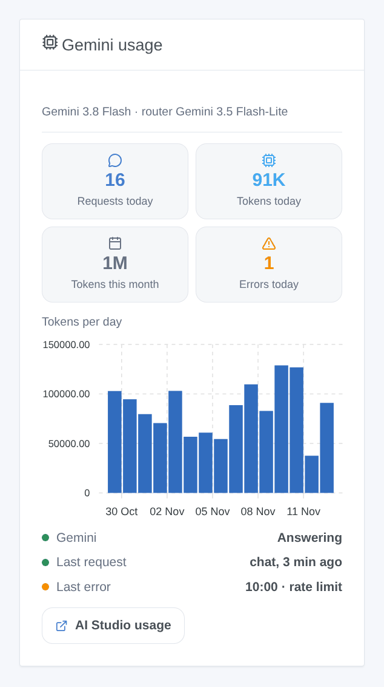

# Google Gemini

## Overview

This integration runs the assistant of Gladys on **Google Gemini**, through the official Gemini API and your own API key from Google AI Studio. Once you choose it in **Settings → Artificial Intelligence**, every AI request of Gladys goes to Gemini: the chat and the devices it controls, the scenes it creates, the "ask the AI" scene action and the weekly digest. It works with or without a Gladys Plus account, and the free tier of the Gemini API is enough to start.

It also adds two scene triggers (the assistant fails, the assistant answers again) and a dashboard widget of your consumption.

Not affiliated with Google. Not tested with a real Gemini key yet: feedback welcome.

## Prerequisites

- Gladys Assistant 5.3.0 or later.
- A Google account and a Gemini API key: [Google AI Studio](https://aistudio.google.com/apikey), **Create API key**.
- **Free tier**: enough for a home, with low limits per minute and per day (shown in AI Studio, Rate limit); Gemini 4 Argon is not in it. **With a billing account** (paid tier): higher limits, every model, billed per token.
- **Your data**: outside the European Economic Area, Switzerland and the United Kingdom, Google may use the requests of the free tier to improve its products, and people may read them. In those countries, and everywhere with a billing account, Google does not. The integration sends every request with logging off (`store: false`).
- What leaves your home: every chat message, the history, the tools Gladys offers and their results (the state of the devices Gemini reads) and the chat images go to Google over HTTPS. Gemini's answers control your devices and create scenes.

## Configuration

| Field or button                | Default               | Meaning                                                                          |
| ------------------------------ | --------------------- | -------------------------------------------------------------------------------- |
| Gemini API key                 | —                     | Required. Never shown again, never logged                                        |
| Chat model                     | Gemini 3.8 Flash      | Answers the chat, creates scenes, writes the weekly digest                       |
| Router model                   | Gemini 3.5 Flash-Lite | Sorts every message before the answer and must reply within 20 seconds           |
| Other model id                 | —                     | Only when a model is set to "Other model": the exact API id (it must call tools) |
| Thinking of the chat model     | Medium                | More thinking, better scenes, slower and costlier answers                        |
| Maximum answer length (tokens) | 16000                 | Thinking included; Google advises 32768 for Gemini 4 Argon                       |
| Test the connection            | —                     | One short answer from each model with its time; spends a few tokens              |

The status of the configuration screen says whether Google accepts the key and both models, without spending a token. Reading a model does not prove that your project may generate (free tier unavailable, billing to set up): **Test the connection** does.

## Usage

1. Integrations → **Google Gemini** → Configuration: paste the API key, keep the default models, press **Test the connection**.
2. Settings → **Artificial Intelligence**: choose **Google Gemini**.
3. Talk to Gladys in the chat: "turn on the living room", "what is the temperature in the bedroom?", "create a scene that closes the shutters at sunset".

### Choosing the models

- **Gemini 3.8 Flash** (default for the chat): the most capable model of the free tier, good at calling tools and creating scenes.
- **Gemini 4 Argon**: the most capable, for a project with billing only.
- **Gemini 3.6 Flash**: the previous Flash, still supported.
- **Gemini 3.5 Flash-Lite** (default router) and **Gemini 3.1 Flash-Lite**: fast and cheap; less reliable to create scenes. Google plans to shut 3.1 Flash-Lite down in May 2027.
- **Other model**: a newer Gemini model or a preview. If it refuses the thinking level, the integration sends it without from then on.

Gemini always thinks a little: **minimal** is the least, and Gemini 3.8 Flash and Gemini 4 Argon start at **low**. The router always uses the least thinking its model accepts.

### Dashboard widget

The **Gemini usage** widget shows the requests and tokens of the day, the tokens of the month, the errors of the day, the tokens per day over 30 days, whether Gemini answers, the last request and the last error. It counts what Gladys asked, thinking included; Google AI Studio stays the reference for the bill.

### Scenes

- **Trigger "Gemini: the assistant fails"**: once per failure (key refused, billing or free tier, rate limit, model unavailable, API unreachable, too slow, Gemini error), with the kind, the message, the request and the model.
- **Trigger "Gemini: the assistant answers again"**: the first answer after a failure, with the minutes of failure.

Examples: when the assistant fails because of the rate limit, send a Telegram message to the administrator; when it answers again, send another one with the minutes of failure.

There is no web search action: the terms of Grounding with Google Search require showing Google's search suggestions with each answer, which a scene notification cannot do.

## Troubleshooting

- **"Google refused the API key"**: copy the key again from Google AI Studio; a deleted key, or a key reported as leaked, gives the same message.
- **"Google refuses to run … for this project"**: the free tier is not available for this project, or the billing account needs attention; open Google AI Studio, Billing.
- **"Rate limit reached"**: the free tier allows few requests per minute and per day (per project, reset at midnight Pacific time). A chat turn makes at least two requests. Wait, choose a lighter router, or link a billing account.
- **"… is not available to this API key"**: the model does not exist, or was shut down; choose another one.
- **The chat answers without doing anything**: try Gemini 3.8 Flash with medium thinking; the Flash-Lite models are less reliable with many tools.
- **"The answer was cut at max_tokens"**: raise the maximum answer length, or lower the thinking.
- **"Gemini stopped the answer (SAFETY)"**: Google's filters blocked the request or the answer; rephrase it.
- Logs: Settings → Supervision, the logs of the integration. Never share your API key.
