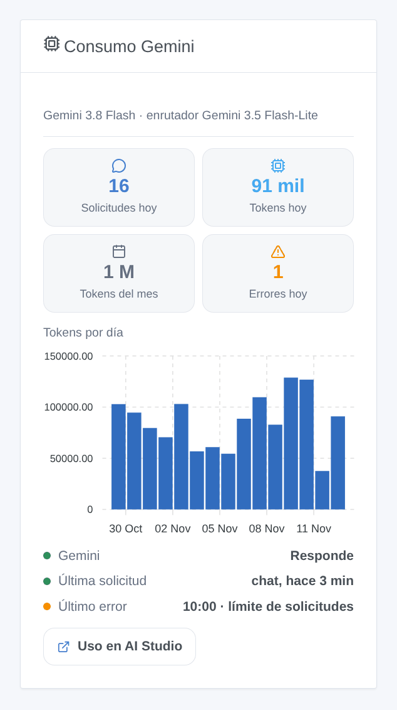

# Google Gemini

## Presentación

Esta integración hace funcionar el asistente de Gladys con **Google Gemini**, a través de la API oficial de Gemini y su propia clave de API de Google AI Studio. Una vez elegida en **Ajustes → Inteligencia artificial**, todas las solicitudes de IA de Gladys van a Gemini: el chat y los dispositivos que controla, las escenas que crea, la acción de escena «preguntar a la IA» y el resumen semanal. Funciona con o sin cuenta Gladys Plus, y el nivel gratuito de la API de Gemini basta para empezar.

También añade dos desencadenantes de escena (el asistente falla, el asistente vuelve a responder) y un widget de panel con su consumo.

No afiliada a Google. Todavía no probada con una clave real de Gemini: sus comentarios son bienvenidos.

## Requisitos previos

- Gladys Assistant 5.3.0 o posterior.
- Una cuenta de Google y una clave de API de Gemini: [Google AI Studio](https://aistudio.google.com/apikey), **Create API key**.
- **Nivel gratuito**: suficiente para una casa, con límites bajos por minuto y por día (visibles en AI Studio, Rate limit); Gemini 4 Argon no está incluido. **Con una cuenta de facturación** (nivel de pago): límites más altos, todos los modelos, facturación por token.
- **Sus datos**: fuera del Espacio Económico Europeo, Suiza y el Reino Unido, Google puede usar las solicitudes del nivel gratuito para mejorar sus productos, y algunas personas pueden leerlas. En esos países, y en cualquier lugar con una cuenta de facturación, no es así. La integración envía cada solicitud con el registro desactivado (`store: false`).
- Lo que sale de su casa: cada mensaje del chat, el historial, las herramientas que ofrece Gladys y sus resultados (el estado de los dispositivos que Gemini consulta) y las imágenes del chat van a Google por HTTPS. Las respuestas de Gemini controlan sus dispositivos y crean escenas.

## Configuración

| Campo o botón                             | Por defecto           | Significado                                                                               |
| ----------------------------------------- | --------------------- | ----------------------------------------------------------------------------------------- |
| Clave de API de Gemini                    | —                     | Obligatoria. Nunca se vuelve a mostrar ni se registra                                     |
| Modelo del chat                           | Gemini 3.8 Flash      | Responde al chat, crea escenas, redacta el resumen semanal                                |
| Modelo del enrutador                      | Gemini 3.5 Flash-Lite | Clasifica cada mensaje antes de la respuesta y debe contestar en menos de 20 segundos     |
| Identificador del otro modelo             | —                     | Solo si un modelo está en «Otro modelo»: el identificador exacto (llamada a herramientas) |
| Razonamiento del modelo del chat          | Medio                 | Más razonamiento, mejores escenas, respuestas más lentas y caras                          |
| Longitud máxima de una respuesta (tokens) | 16000                 | Razonamiento incluido; Google aconseja 32768 para Gemini 4 Argon                          |
| Probar la conexión                        | —                     | Una respuesta corta de cada modelo con su tiempo; consume algunos tokens                  |

El estado de la pantalla de configuración indica si Google acepta la clave y los dos modelos, sin consumir tokens. Leer un modelo no prueba que su proyecto pueda generar (nivel gratuito no disponible, facturación por configurar): **Probar la conexión** lo comprueba.

## Uso

1. Integraciones → **Google Gemini** → Configuración: pegue la clave de API, mantenga los modelos por defecto y pulse **Probar la conexión**.
2. Ajustes → **Inteligencia artificial**: elija **Google Gemini**.
3. Hable con Gladys en el chat: «enciende el salón», «¿qué temperatura hace en el dormitorio?», «crea una escena que cierre las persianas al atardecer».

### Elegir los modelos

- **Gemini 3.8 Flash** (por defecto para el chat): el modelo más capaz del nivel gratuito, bueno para llamar a herramientas y crear escenas.
- **Gemini 4 Argon**: el más capaz, solo para un proyecto con facturación.
- **Gemini 3.6 Flash**: el Flash anterior, todavía compatible.
- **Gemini 3.5 Flash-Lite** (enrutador por defecto) y **Gemini 3.1 Flash-Lite**: rápidos y baratos; menos fiables para crear escenas. Google prevé retirar 3.1 Flash-Lite en mayo de 2027.
- **Otro modelo**: un modelo de Gemini más reciente o una versión preliminar. Si rechaza el nivel de razonamiento, la integración lo envía sin él a partir de entonces.

Gemini siempre razona un poco: **mínimo** es lo menos, y Gemini 3.8 Flash y Gemini 4 Argon empiezan en **bajo**. El enrutador usa siempre el razonamiento más bajo que acepta su modelo.

### Widget de panel

El widget **Consumo Gemini** muestra las solicitudes y tokens del día, los tokens del mes, los errores del día, los tokens por día durante 30 días, si Gemini responde, la última solicitud y el último error. Cuenta lo que Gladys ha pedido, razonamiento incluido; Google AI Studio sigue siendo la referencia para la factura.

### Escenas

- **Desencadenante «Gemini: el asistente falla»**: una vez por fallo (clave rechazada, facturación o nivel gratuito, límite de solicitudes, modelo no disponible, API inaccesible, demasiado lento, error de Gemini), con el tipo, el mensaje, la solicitud y el modelo.
- **Desencadenante «Gemini: el asistente vuelve a responder»**: la primera respuesta tras un fallo, con los minutos de fallo.

Ejemplos: cuando el asistente falla por el límite de solicitudes, enviar un mensaje de Telegram al administrador; cuando vuelve a responder, enviar otro con los minutos de fallo.

No hay acción de búsqueda web: las condiciones de la fundamentación con la Búsqueda de Google exigen mostrar las sugerencias de búsqueda de Google con cada respuesta, algo que una notificación de escena no puede hacer.

## Solución de problemas

- **«Google ha rechazado la clave de API»**: vuelva a copiar la clave desde Google AI Studio; una clave eliminada, o señalada como filtrada, da el mismo mensaje.
- **«Google se niega a ejecutar … para este proyecto»**: el nivel gratuito no está disponible para este proyecto, o la cuenta de facturación requiere atención; abra Google AI Studio, Billing.
- **«Se ha alcanzado el límite de solicitudes»**: el nivel gratuito admite pocas solicitudes por minuto y por día (por proyecto, se reinician a medianoche, hora del Pacífico). Un turno de chat hace al menos dos solicitudes. Espere, elija un enrutador más ligero o vincule una cuenta de facturación.
- **«… no está disponible para esta clave de API»**: el modelo no existe o ha sido retirado; elija otro.
- **El chat responde sin hacer nada**: pruebe Gemini 3.8 Flash con razonamiento medio; los Flash-Lite son menos fiables con muchas herramientas.
- **«The answer was cut at max_tokens»** (mensaje en inglés): aumente la longitud máxima de una respuesta o baje el razonamiento.
- **«Gemini stopped the answer (SAFETY)»** (mensaje en inglés): los filtros de Google han bloqueado la solicitud o la respuesta; reformúlela.
- Registros: Ajustes → Supervisión, registros de la integración. Nunca comparta su clave de API.
